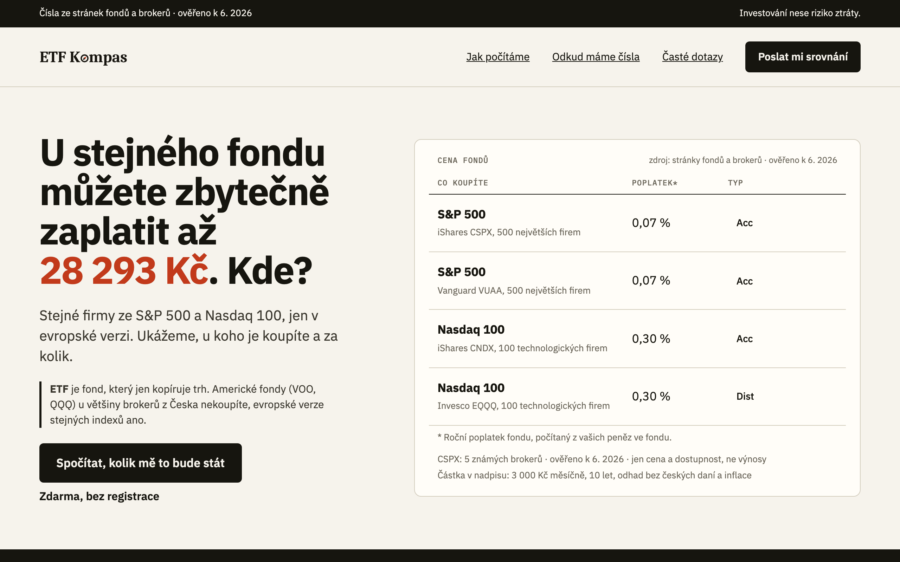
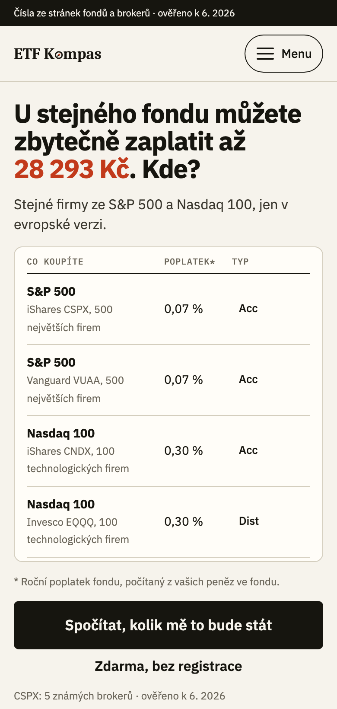
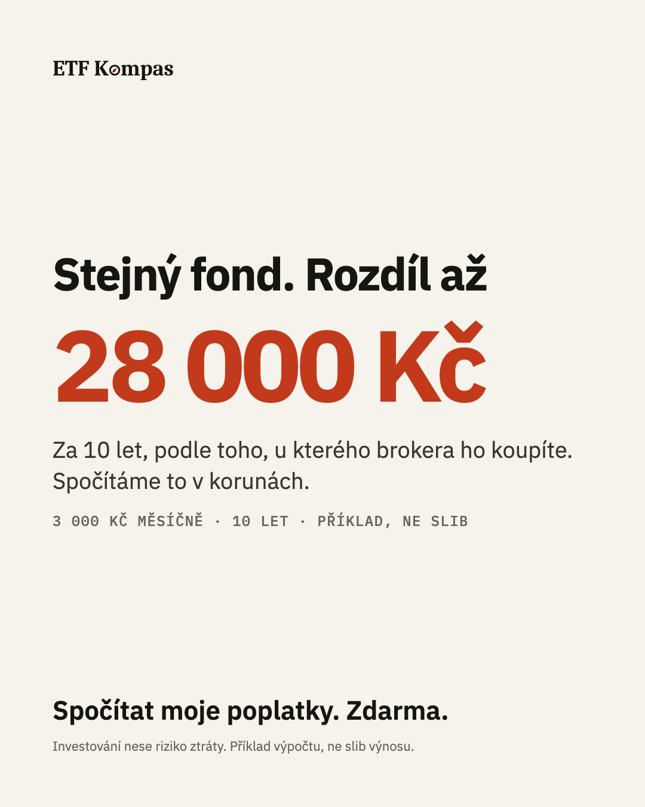
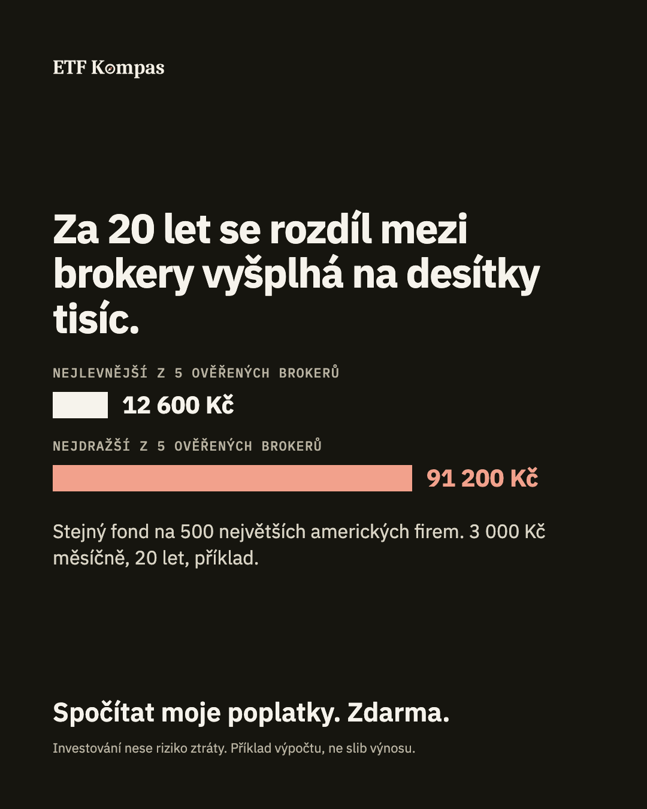
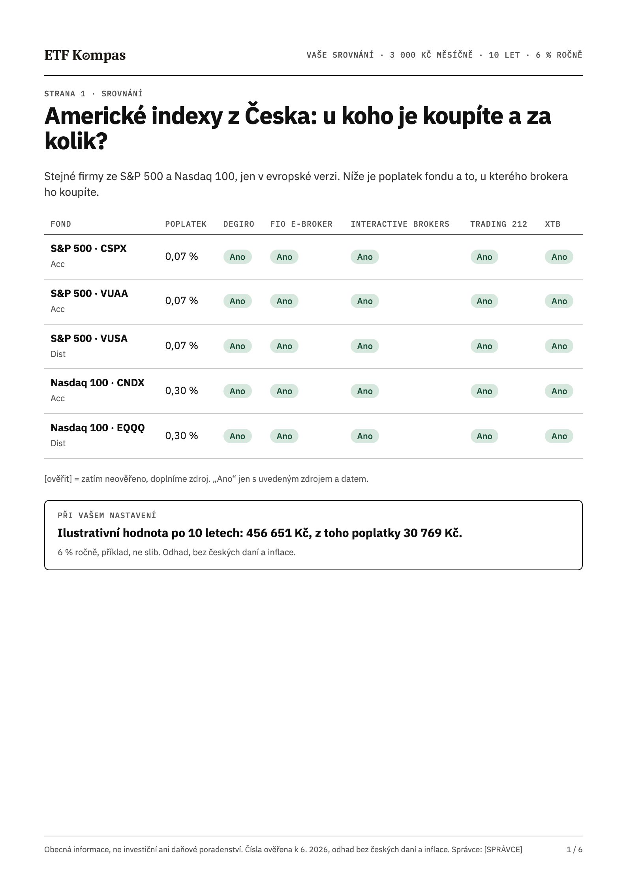

# ETF Kompas

A Czech-language, mobile-first landing page that answers one question for a first-time investor: _what does the fund I can actually buy cost me in korunas, at each broker?_ The visitor enters a monthly amount and a horizon, sees the cost split into fund fee, conversion of korunas and broker fees, and gets the full comparison of 5 funds and 5 brokers as a results page and a personalised 6-page PDF in exchange for an e-mail address.

It is a test project for Clientelo, built with Claude Code agents under the author's review. **It is a demo, not a launched product:** the site is `noindex`, no paid traffic has run, and the legal text is placeholder text that no lawyer has seen (see [section 11](#11-what-is-missing-and-known-risks)).

- **Live demo:** https://etf-kompas-kappa.vercel.app (noindex)
- **Source of truth:** [docs/SPEC.md](docs/SPEC.md). Phases and status: [docs/PHASES.md](docs/PHASES.md). Decisions: [docs/decisions/](docs/decisions/) (68 notes). AI work log: [docs/AI-LOG.md](docs/AI-LOG.md).
- A Czech version of this README (`README.cs.md`) is **not written**; the spec puts it after the P0 and P1 work.

**What it looks like** (wireframes, rev. 7; the full set is in [docs/design/images/](docs/design/images/) and in the Wireframe Board and Design Study in [docs/design/wireframes/](docs/design/wireframes/)):



   

## Contents

1. [Target audience and the "NYSE vs UCITS" decision](#1-target-audience-and-the-nyse-vs-ucits-decision)
2. [Offer, gate moment, form, post-submit](#2-offer-gate-moment-form-post-submit)
3. [The two ads and the UTM scheme](#3-the-two-ads-and-the-utm-scheme)
4. [Section order and rationale](#4-section-order-and-rationale)
5. [Interactive element and methodology](#5-interactive-element-and-methodology)
6. [Data sources](#6-data-sources)
7. [Tracking plan and how to read the funnel](#7-tracking-plan-and-how-to-read-the-funnel)
8. [Expected conversion and assumptions](#8-expected-conversion-and-assumptions)
9. [Three A/B hypotheses](#9-three-ab-hypotheses-ranked-by-expected-impact)
10. [How the work was done with AI](#10-how-the-work-was-done-with-ai)
11. [What is missing and known risks](#11-what-is-missing-and-known-risks)
12. [Run, test, deploy](#12-run-test-deploy)

## 1. Target audience and the "NYSE vs UCITS" decision

**Audience.** A Czech person of 25 to 40, on a phone, who sees an ad for 3 to 5 seconds. They have money in a bank account, have heard the word "ETF" but cannot explain it, and do not know TER, UCITS or withholding tax. Their main fear is paying fees they do not know about. Everyone who already compares funds by TER is excluded on purpose. Consequence: plain Czech, every cost in Kč, no jargon (the enforced glossary and rules are SPEC §25 and `pnpm copy:check`).

**The decision.** The brief says "NYSE-traded ETFs". US-domiciled funds such as VOO or QQQ generally cannot be bought by EU retail clients at most brokers (they lack a PRIIPs KID), and tax treatment differs (US withholding and estate-tax exposure against an Irish UCITS fund). Czech retail investors in practice buy UCITS twins that track the same index. So the page keeps the hook people search for (S&P 500, Nasdaq 100, "from Czechia") and makes its value the honest answer: _these are the funds everyone talks about; here is what the one you can really buy costs you, at each broker._ The US originals VOO and QQQ appear only to say where they cannot be bought. Reasoning and consequences: SPEC §1 and notes [0006](docs/decisions/0006-nyse-etfs-vs-ucits-framing.md), [0036](docs/decisions/0036-fund-set-five-twins.md).

**Claims on the page are limited to what is proven.** The count of brokers that do not sell VOO or QQQ uses only brokers verified as "no" (note [0066](docs/decisions/0066-drop-unused-unverified-data-fields.md)); there is no past-performance figure anywhere (note [0008](docs/decisions/0008-no-past-performance-in-ads-or-ungated-page.md)); no broker is called "cheapest".

## 2. Offer, gate moment, form, post-submit

- **Free, before any e-mail:** the calculator, the cost of the fund that can be bought (CSPX) in Kč split into three parts, a table of four European twins (annual fee, accumulating or distributing), and the explanation of what is not counted.
- **For an e-mail address ("ETF Kompas 2026"):** the comparison of 5 funds at 5 brokers (is it sold, the broker's fees, the total over the visitor's horizon, each with source and date), the three-card tax explanation, the "where to buy" facts, shown as an interactive results page and as a **personalised 6-page PDF** (valid 30 days like the link).
- **When we ask:** once, directly under the calculator result, in an inline panel. Not before the calculator (it would kill conversion on cold traffic), not as a modal. A sticky bar and the header button jump to the same form.
- **The form:** one required field (e-mail), the button says what it does ("Poslat mi srovnání"), `inputmode="email"`, large touch target, no captcha (a hidden honeypot field, a minimum fill time and rate limits: 5 requests per hashed IP an hour, 3 e-mails per hashed address a day). A separate, optional, unticked box asks for tips; the comparison does not depend on it, and the tips need a confirmation by a button (double opt-in).
- **After submit:** the same screen shows "Otevřít srovnání" first and "Stáhnout PDF" second, so no one depends on e-mail delivery. The e-mail with the same links arrives within about a minute. Every e-mail has an unsubscribe link that works with one click and can be undone. A phone step ("leave your number") was moved out of scope until the lead recipient is defined (SPEC §17.4).
- **Where leads go (an open business question):** nowhere. They stay in one list owned by the controller and are **not passed to brokers or anyone else**; the controller details are placeholders (`src/config/site.ts`). Clientelo has to say who the controller is and what a lead is worth to it.

## 3. The two ads and the UTM scheme

Both ads run on Meta (feed 4:5 and Stories 9:16) with a Google/Sklik search twin; the creatives are drawn in the Wireframe Board and the Design Study ([docs/design/](docs/design/), text in [wireframe-b.md](docs/design/wireframe-b.md)) and are **not built or run**. Ads A and B were replaced on 2026-10-15 by two of ten new drafts; the old "? z 5" and twins ads are gone from the boards.

- **Ad A, "the gap in korunas" (saving):** a typographic card, "Stejný fond. Rozdíl až 28 000 Kč", with "Za 10 let, podle toho, u kterého brokera ho koupíte." and "3 000 Kč měsíčně · 10 let · příklad, ne slib"; CTA "Spočítat moje poplatky. Zdarma." The amount is the gap between the dearest and the cheapest verified broker for the S&P 500 fund, rounded down (28 286 Kč with the data of 2026-10-14).
- **Ad B, "the same gap over 20 years" (horizon):** a dark card, "Za 20 let se rozdíl mezi brokery vyšplhá na desítky tisíc", with two bars, the cheapest ("12 600 Kč") and the dearest ("91 200 Kč") of five verified brokers, none named (12 630 and 91 238 Kč with the data of 2026-10-14). The amounts must be recomputed on launch day.
- **Landing pages:** the ads do not have different heroes. Both ad sets send traffic to `/?v=a` and `/?v=b`, split equally; the pages share one layout and differ only in the headline (neutral question against a loss-framed amount in Kč). Note [0041](docs/decisions/0041-ab-test-hero-headline.md).
- **Compliance in the ads:** no promised return, no "get rich" wording, a risk line in the image and the text, and the platforms' current rules for financial products to be checked before any spend (not checked).
- **UTM scheme:** `utm_source=meta|google|sklik`, `utm_medium=paid_social|cpc`, `utm_campaign=etf-kompas-2026-10`, `utm_content={a|b}-{4x5|9x16|rsa}`, `utm_term` for search. Every landing link also carries `?v=a|b`. UTM values, `fbclid`, the variant and `in_app_browser` are stored with the events (and the UTM values with the lead).

## 4. Section order and rationale

The order is fixed by the wireframe (revision 6, [docs/design/](docs/design/)):

1. Top bar ("Čísla ze stránek fondů a brokerů · ověřeno k …", the date generated from the data) and header.
2. **Hero** that fits a 375 x 667 phone screen with its button: headline, the four-twin table, button, the one-line explanation of "ETF" (the only place the word is explained).
3. **Calculator and live result**, a dark band directly under the hero.
4. **E-mail form**, directly under the result.
5. "Za co platíte, aniž to vidíte": three cards (fund fee, conversion of korunas, tax on profit).
6. "Co dostanete e-mailem": a preview of two PDF pages.
7. Trust block: where the numbers come from, how they are counted, "we sell nothing".
8. Four questions (can I buy an American fund from Czechia, is it free, what do you do with my e-mail, do you advise me).
9. Footer: risk and not-advice text, controller, links, the test-project notice. A sticky button bar appears after the first scroll on a phone.

**Why this order:** the table already proves there is something worth knowing before any interaction, the calculator turns it into the visitor's own number, and the ask sits at the point of maximum curiosity. Everything after the form catches the visitor who did not convert at once (what is hidden in the cost, what they get, who is behind it, objections). Performance budget: route JS at most 150 KB gzipped (a Playwright test fails CI above it; it stands at 149.97 KB, see section 11).

## 5. Interactive element and methodology

**A cost calculator** rather than a portfolio builder or a plain table: it produces a personalised number in Kč in under 10 seconds, and the result raises the next question ("which broker?"), which the gate answers.

- **Inputs:** monthly amount (slider, 500 to 20 000 Kč in steps of 500, default 3 000) and horizon (5, 10 or 20 years, default 10). One purchase a month, no lump sum. The fund is CSPX; each broker is priced at its cheapest listing of it.
- **Assumption:** a fixed 6 % gross return a year, the same for every fund so that only costs differ, always labelled "příklad, ne slib", shown net of fees. There is no control to change it (note [0010](docs/decisions/0010-six-percent-illustrative-return.md)).
- **Output:** the cost over the horizon in three parts: fund fee, conversion of korunas, broker fees (purchase commission and custody). The headline is the cost at the most expensive verified broker, worded "může u ověřených brokerů stát i X", and the green box "až X" (the spread between brokers) appears only when at least two brokers have verified prices. While no broker is priced only the fund-fee part is shown. Taxes and inflation are not counted.
- **Exchange rate:** the Czech National Bank's daily file, fetched by the server and cached for 12 hours. There is no stored fallback (it would be too old to use within days, note 0066): without the bank's answer the page shows the fund fee only.
- **Where the maths lives and how to check it:** pure functions in `src/server/` (`cost.ts`, `broker-pricing.ts`, `cnb.ts`), unit-tested; the formulas, the fee model and the hand-computed golden cases are in [docs/METHODOLOGY-V2.md](docs/METHODOLOGY-V2.md). The browser receives only verified inputs (`calculatorData`); the results page and the PDF are computed on the server from the stored amount and years.
- **Limits worth knowing:** the 6 % and one fee model per broker are simplifications; several broker records rest on soft evidence (section 11); the calculator is an "orientační odhad nákladů", not a prediction.

## 6. Data sources

Every number carries `{value, sourceUrl, asOf, verifiedBy, verifiedOn, evidence}` in `data/*.json` ([data/README.md](data/README.md)). `evidence` is an archive link or the SHA-256 of the saved source file; **the source PDFs themselves are not committed** (the repo is public). Nothing is typed from memory or from a language model; an unknown value is `TODO_VERIFY`.

- **Funds (5 European twins + 2 American originals):** iShares Core S&P 500 UCITS (CSPX), Vanguard S&P 500 UCITS Acc (VUAA) and Dist (VUSA), iShares Nasdaq 100 UCITS (CNDX), Invesco EQQQ Nasdaq-100 UCITS (EQQQ); VOO and QQQ only for availability. Sources: issuer factsheets and key information documents (Vanguard, iShares, Invesco). VOO and QQQ carry no records, only their tickers and the broker availability.
- **Brokers (5, alphabetical, no ranking by commission):** DEGIRO, Fio banka, Interactive Brokers, Trading 212, XTB. Sources: each broker's fee schedule (DEGIRO's fee overview, Trading 212's costs and charges, XTB's fee table, Fio's pages on trading in Germany and currency conversion, Interactive Brokers Ireland's commission and currency pages) and, for what a broker sells, the broker's own instrument search.
- **No tax figure is on the page.** The dividend yield and withholding rate once stored for the old calculator (from the Czech-US treaty and the US-Ireland convention) were dropped because nothing used them (note 0069). The Czech tax explanation is **partly written** (note 0072): the exemption of a sale after 3 years, the 100 000 Kč yearly limit, and that a fund's payout is capital income stand on the comparison page and on page 4 of the PDF. Each sentence is built from a sourced record in `data/tax.json` (law text, Finanční správa, Pokyn GFŘ-D-59) and links its source. The rest says `[ověřit zdroj]`. [docs/TAX-SOURCES.md](docs/TAX-SOURCES.md) lists what is still open, as a basis for a qualified reviewer; it is not legal text. The third card of "Za co platíte" stays `[ověřit zdroj]` on purpose.
- **20 sources in total:** [data/sources.json](data/sources.json).
- **The rules a build enforces (`pnpm data:validate`, strict):** no `TODO_VERIFY`, every value has a source from `sources.json` and evidence, no record older than 120 days (45 days for broker fees). It runs in CI on `main` and before every Vercel build, so a stale record stops a deploy: the first one expires on 2026-10-25. There is no automated "refresh data" job yet.
- **What is weak:** the Fio conversion rate and Fio's VOO and QQQ come from demo-account screens, the Interactive Brokers conversion fee from a footnote ("typically", "at its discretion"), and some listings rest on a ticker match instead of an ISIN. Listings in GBP, GBX and CHF are not recorded (the model has CZK, EUR and USD only). Details: section 11.

## 7. Tracking plan and how to read the funnel

**Consent first** (SPEC §9, notes [0062](docs/decisions/0062-in-house-consent-banner.md) to [0065](docs/decisions/0065-one-events-table-lead-once-per-email.md)): an in-house cookie bar and settings ("Přijmout vše" and "Odmítnout vše" equally prominent; measurement and advertising off until agreed), built without React hydration to stay inside the JavaScript budget. GA4 and the Meta Pixel are loaded only after their category is agreed (Google Consent Mode v2), and a test asserts zero third-party requests before consent and after "Odmítnout vše".

**Events** (a small inline script, one `track()` path, stored by `POST /api/event` in the Supabase `events` table; `?debug=1` prints them to the console). Every event carries `variant`, `utm_*`, `session_id`, `device` and `in_app_browser`:

| Event         | Fires when                                                                             |
| ------------- | -------------------------------------------------------------------------------------- |
| `page_view`   | the page loads                                                                         |
| `calc_start`  | the first change of the slider or a horizon chip                                       |
| `calc_result` | the result has been in view for 1 s after `calc_start` (with amount and years buckets) |
| `gate_view`   | the form is half in view                                                               |
| `form_focus`  | the e-mail field gets focus                                                            |
| `lead`        | **the server** stores a new e-mail (once per new address, not on a repeat)             |

Not built: `scroll_*`, `form_submit_attempt`, `form_error`, `kompas_download`, `results_open`, `lead_qualified` (cut as optional) and the funnel dashboard (P1, cut). **`lead`** carries an `event_id` shared by the browser and the server for GA4 and Meta; the GA4 Measurement Protocol is not built because it would count each lead twice (section 11). First-party events are written even when third-party consent is refused: cookieless, aggregate, no IP, no user agent (legal sign-off is open).

**Reading the funnel.** There is no dashboard. In the Supabase SQL editor, per variant and per period (written from the table definition in `supabase/migrations/0003_events.sql`, not run against production data in this form):

```sql
select
  variant,
  count(distinct session_id) filter (where name = 'page_view')   as visits,
  count(distinct session_id) filter (where name = 'calc_start')  as calc_start,
  count(distinct session_id) filter (where name = 'calc_result') as calc_result,
  count(distinct session_id) filter (where name = 'gate_view')   as gate_view,
  count(distinct session_id) filter (where name = 'form_focus')  as form_focus,
  count(*)                   filter (where name = 'lead')        as leads
from events
where created_at > now() - interval '7 days'
group by variant
order by variant;
```

Read it as: visits to `calc_start` (interest), `calc_start` to `calc_result` (the calculator works), `calc_result` to `lead` (the ask), visits to `lead` (the headline number). Two cautions: a session before consent lasts one page load, so one person can appear as two sessions; and `lead` has no `session_id`, so a lead cannot be joined to a visit. Add `where in_app_browser` to see only Instagram and Facebook visitors. Lead quality (the amount and years in the lead row) is in `leads`, which holds e-mail addresses: query it only as the controller.

## 8. Expected conversion and assumptions

These are assumptions, not measurements, to be replaced by the first 500 sessions. Cold paid-social mobile traffic, e-mail-only form, value shown before the ask: visit to `calc_start` 30 to 40 %, `calc_start` to `calc_result` 70 to 80 %, `calc_result` to `lead` 25 to 35 %. Visit to lead: about 8 % (plausible range 4 to 14 %). Reasoning: generic finance lead-gen pages report single-digit conversion; an interactive result with a one-field form should beat the median, while cold social traffic with a 3-second attention span caps it (SPEC §10).

Test sizing: about 3,200 visitors per variant to detect 8 % against 10 % visit-to-lead (80 % power, 5 % significance), about 900 for 8 % against 12 %. At an assumed 10 Kč per click that is roughly 32,000 or 9,000 Kč per variant (the click price is an assumption, SPEC §28). These tests are slow, and decisions on small samples are noise.

**Lead economics (SPEC §28).** Clientelo has not given the value of a lead, a cost target or click prices, so none is invented. Expected cost per lead = cost per click / visit-to-lead rate. At the base-case 8 %, an assumed 6 Kč click gives 75 Kč a lead, 10 Kč gives 125 Kč, 15 Kč gives 188 Kč (all click prices are assumptions; at the pessimistic 4 % each figure doubles). The maximum acceptable cost per lead is the chance that a lead becomes a customer times what a customer is worth, and **both numbers must come from Clientelo**. The question for Clientelo: _what is a lead worth to you, and what cost per lead do you consider acceptable?_ Targets should be set after the first 500 sessions of real data.

## 9. Three A/B hypotheses, ranked by expected impact

1. **Gate placement and format.** Showing the headline cost in Kč ungated and gating only the full comparison converts better than gating the calculator result. Metric `calc_result` to `lead`; guard: bounce, lead quality.
2. **Hero framing.** A loss-framed numeric headline ("U stejného fondu můžete zbytečně zaplatit až X XXX Kč. Kde?") beats the neutral question for cold mobile traffic. Metric visit to `calc_start`. This is the first test: `?v=a` against `?v=b` (note 0041).
3. **Form friction.** E-mail only gives more leads than e-mail plus optional amount chips, but the second may lower cost per qualified lead. Metric CPL and `lead_qualified` rate.

Order of running: 2, then 1, then 3, because test 2 needs only copy and test 1 needs a second build. Every event carries `variant`.

### How test 2 would be run (designed, not run)

**Status: no ad money has been spent and the test has not been run.** The launch gate keeps paid traffic off, and the tracking and the lead flow that would measure it were built after this text was written, so a result could not be read today (the tracking and the lead flow now exist; the budget and the ad accounts do not).

- **The two pages.** The variants are two URLs of the same page: `/?v=a` (the neutral question) and `/?v=b` (the headline with the amount; served only while at least two brokers have verified prices, otherwise the visitor gets `a`). The page marks the variant it really showed in `data-variant`; that mark, not the URL, is what a count should use (note 0041).
- **Who splits the traffic.** The plan is to let the ad platform do it: create the two ads as a Meta A/B test in Ads Manager, one link ending in `?v=a`, the other in `?v=b`. The platform divides the audience randomly into groups that do not overlap, which two ordinary ads would not do (each ad is shown to different people, so the split would not be random). No code is needed for this. Meta's current Ads Manager screens and pricing were not checked here; the other platforms (Google, Sklik) have their own experiment tools and were not checked either.
- **The links.** Each ad link also carries the UTM parameters of SPEC §27, where `utm_content` is `{a|b}-{4x5|9x16|rsa}`.
- **What was not chosen.** Assigning the variant ourselves from the click id (`fbclid`) in a small `proxy.ts`. It would give one method for every platform and a split we can verify, but it uses the id before any consent, which nobody has reviewed legally. It stays an option if the platforms' own tools cannot be used.
- **What would be needed first.** A budget (about 3,200 visitors per variant for 8 % against 10 %, see above), the tracking of Phase 5 with `variant` on every event, and the lead flow of Phase 4.

## 10. How the work was done with AI

**Setup.** The pages, the maths, the data tooling and the tests were written by Claude Code agents; the author (David) set the spec, reviewed every pull request, supplied and checked the source documents, and decided every question the spec left open. 97 pull requests at the time of writing, each one concern, Conventional Commit titles, never pushed to `main`, CI on every one (format, lint, types, ~920 unit and component tests, the data check, contrast, the Czech copy lint, a production build and ~200 Playwright tests).

**Instructions.** [CLAUDE.md](CLAUDE.md) holds the rules the agents worked under (SPEC §15): work from the spec only; never invent data, sources, URLs or legal statements (`TODO_VERIFY`); all Czech text in one file, linted against a plain-language glossary; no dependency without a one-line reason; tests written and approved before risky logic (calculator, data validator, lead handling, retention); keep `docs/AI-LOG.md` current as mistakes happen; suggest a decision note instead of deciding silently, and draft it only with the author's own reason. The agent was told to ask before changing the spec, and 68 decision notes record what was decided and why.

**Validation, in the order it caught things.**

1. **Tests first, approved by the author**, then code: the calculator, the data validator, the lead flow, the retention purge. The author computed golden calculator cases by hand from the broker documents.
2. **A strict data validator** that fails a build on a missing source, a placeholder or a stale record.
3. **Checkers that encode taste and rules:** `pnpm copy:check` (glossary, banned wording), a WCAG contrast check of every colour pair, a JavaScript budget test, geometry tests (the hero fits 375 x 667).
4. **Reading the sources:** the author supplied or confirmed the fund and broker documents, and every value is signed `verifiedBy` with the document's SHA-256 in its evidence; the agent was told to say when it could not read one, and several times did.
5. **Real devices and real accounts:** the author's phone in Instagram and Messenger, a real GA4 property, a real sending domain, a real Vercel deploy. Several of the mistakes below were found only this way.

**Where the AI was wrong** (every entry is in [docs/AI-LOG.md](docs/AI-LOG.md), with the prompt and the fix; this is a selection):

- **Data and sources.** The agent said saved documents existed when they did not, misread a date, listed a data gap that was not a gap, and once invented a month while writing a note. Where the author supplied a document of the wrong share class (the EQQQ key information document and factsheet were for the CHF-hedged class), the agent noticed from the document itself and said so, but it also read a February document where an August one was the right source for `asOf`. Lesson: a number is checked against the document, never against the agent's word.
- **Claims on the page.** The FAQ said the e-mail is "stored nowhere" for a whole phase after leads were being stored in Supabase; the retention PR found it. The agent argued for its own wording of the headline twice before accepting that the author's ear for his audience decides Czech copy ("může stát i").
- **Lead handling.** A time check the agent wrote dropped real submissions silently; a promise to answer unknown results links with 404 could not be kept on the chosen rendering (they answer 200, note 0057).
- **Not noticing a limit.** The agent blew the JavaScript budget and nearly did not notice (the calculator UI); a spec number could not be met and that was found out only by measuring; the 404 page broke the budget twice.
- **Tests that were wrong, not the code.** Several approved tests asserted the agent's own wrong assumption, and fixed timeouts or regexes made others flaky. The agent reported a phone-menu defect that did not exist.
- **Reporting.** It reported the Lighthouse LCP as "missed" from the simulated number before checking the measure the spec gates on (the applied one), and once wrote an AI-LOG entry about a mistake that never happened (caught before it was published).
- **Deployment.** The first redeploy with a changed `SITE_URL` failed the whole build, because the agent used `new URL()` on it at build time without a guard (now fixed, and the bad value only warns).
- **A pattern in the log:** the entries are mostly about things the agent had not looked at, or had looked at in the wrong mode, before stating them as true.

**What the author decided and checked:** every question the spec left open (the decision notes carry his reasons, and a note is drafted only after he gives one), the retention periods (provisional, "for now"), whether a source counts as evidence, and the Czech copy, which the agent wrote and the author reviewed while building (one final pass is still planned).

## 11. What is missing and known risks

**The biggest risks, short:**

1. **No legal review.** There is no lawyer on this project. The privacy text, the consent wording, the tips box, the claims about brokers and the retention periods are placeholder or best-effort and unreviewed. [docs/LEGAL-PACK.md](docs/LEGAL-PACK.md) lists the open questions for a reviewer. The site is `noindex` and must not get paid traffic until that is done (SPEC §19.5).
2. **Who receives the leads is undecided.** The controller (name, ID, address) is a placeholder. No lead is shared with anyone.
3. **Vercel Hobby is a non-commercial plan.** A real launch needs Pro or another host.
4. **The data goes stale and a build stops with it.** Every record has a date; the strict check fails a build on a stale one (the first on 2026-10-25), and the monthly refresh job of SPEC §18 is not built.
5. **The Meta Pixel was checked in Test Events (browser side only);** the server-side Meta call is built but not enabled (no token, no Graph version), so the deduplication of the browser and server `Lead` was never seen.
6. **E-mail is in `sandbox` mode on purpose.** The e-mail with the links goes only to an allowlist of reviewers' addresses or domains (`EMAIL_SANDBOX_ALLOWLIST` in Vercel; `@clientelo.cz` allows a whole domain), so no stranger receives mail and no real person's address can reach a project with a placeholder controller and unreviewed legal text. One reason is the free plan of Resend, which allows 100 e-mails a day and 3,000 a month (resend.com/pricing, read on 2026-10-14). Everyone else still gets the results page and the PDF, and the page says nothing about an e-mail. A reviewer whose address is not on the list sees no e-mail; the owner adds it and redeploys. The e-mail comes from the author's test domain; the production switch (a real domain, `live` mode) is a checklist in [docs/DEPLOY.md](docs/DEPLOY.md).

**All known gaps (end of Phase 6, 2026-10-14; brought up to date 2026-10-15)**

What is not done or not right yet, so nobody has to find it:

- **Deployed, but a test project.** The site is live at https://etf-kompas-kappa.vercel.app and is `noindex` on purpose (header and tag). Leads are stored for real (Supabase, EU) and e-mails go out through Resend from the author's test domain, in `sandbox` mode (only to an allowlist) until it is switched to `live`. One real check on the live site: an address on the author's own domain, which is forwarded to another mailbox, did not receive the e-mail (Resend said Delivered; the forwarding loses it), a direct address did. Delivery to Seznam, Gmail and Outlook was not checked.
- **Tracking is checked against the real GA4 only, by the author (2026-10-14).** The cookie bar, the first-party events, GA4 and the Meta Pixel (loaded after their category is agreed, Consent Mode v2) and the lead for the vendors are built and tested with fake ids, stubbed vendor scripts and a stub for the Meta Conversions API; GA4 was then tested by the author with the real property. **Meta, browser side, was verified in Test Events by the author on 2026-10-14** on the deployed address: `PageView`, `ViewContent` and `Lead` (with an event ID) after "Přijmout vše", and nothing at all after "Odmítnout vše". The same run showed one event our code does not send, "Subscribed Button Click" (marked automatic): Meta's own automatic detection, a dataset setting that is not checked or changed here. **Not verified:** the server-side call (the `fbc` format, the event ID matching the browser's, the Graph API version and the access token, which have no default, `TODO_VERIFY`), and INP and TBT with and without consent.
- **The GA4 Measurement Protocol is not built**, against SPEC §9: GA4 does not deduplicate it against the browser event, so it would count every lead twice. GA4 gets the lead from the browser only; an ad-blocker loses it. Meta gets it from the server too, only with advertising consent.
- **A visitor who refuses is counted in aggregate** (first-party events, no cookie, no IP, no user agent, a session of one page load) **and never linked to a lead.** Their lead is missing from GA4 and Meta, so the cost per lead in the ad platforms under-counts. Whether counting before consent is allowed, and the cookie lifetime (180 days), are questions in the legal pack, as are the points of the vendors and the retention of events.
- **`in_app_browser`** is stored on the events, not on the lead row. **The privacy page is out of date:** it says technical data is processed only when cookies are allowed (legal pack point 8). The cookie and measurement wording is the drawing's text, unreviewed.
- **The server-side Meta call is built but not enabled, on purpose** (note 0071): the access token and the Graph API version are not set, so only the browser Pixel sends the lead. Turning it on is a configuration change (the three Meta variables in [docs/DEPLOY.md](docs/DEPLOY.md)) followed by a check in Meta's Test Events; none of that was done. It runs after the response (Next's `after`); a lost call is accepted, no retry.
- **The 5-second test was run with one person**, not the three the spec asks for (note 0052). She understood what the page offers and did not notice that it is free; the line was then made bolder and has not been tested again.
- **The Czech copy** was reviewed by the author while building, not in a separate pass. One final check is planned before it goes live. The privacy policy is filled in (date, bases, processors) except the controller and the contact e-mail, which are placeholders on purpose; it, the consent wording of the tips box and the cookie texts have not been seen by a lawyer.
- **The A/B test is designed, not run** (see above). The way the traffic is split is chosen (Meta's own test) but not set up.
- **Tax text is partly missing.** Not written, so `[ověřit zdroj]`: how an accumulating fund is taxed before the sale (no Finanční správa statement found), the foreign tax credit and the dividend rate, what Ireland withholds, whether the time test runs per purchase (FIFO), and what goes into the tax return. A reviewer's list of ten items is in [docs/TAX-SOURCES.md](docs/TAX-SOURCES.md). The tax records go stale 120 days after 2026-10-14, so from 2027-02-12 the strict data check fails until they are read again.
- **The comparison page lacks the table "Kde fond koupit"** of the drawing. Its data (purchase fees, conversion, custody, Czech language, source and date) is verified and is on page 5 of the PDF. The sections are numbered 1 to 3.
- **An unknown, expired or mistyped results link answers HTTP 200**, with the message "Tento odkaz už nefunguje", not 404: the page streams after a static shell. It is `noindex` and `Cache-Control: private, no-store`. A real 404 would need a Proxy that repeats the lookup.
- **Retention is provisional.** Leads are deleted automatically 6 months after the last contact and 30 days after unsubscribe, events after 6 months (a daily Vercel Cron call of `/api/purge`; `pnpm lead:delete <e-mail>` erases one person by hand). The two periods are David's choice "for now", not a legal decision; the pages say so and `docs/LEGAL-PACK.md` lists it as an open point. The purge is tested against the in-memory store and a mocked Supabase API, **not yet run against the real database or Vercel Cron**. A race between two simultaneous first submits of the same address gives one of them an error answer.
- **The e-mails** have no tracking and no one-click `List-Unsubscribe-Post` (the plain header is set). Delivery to Seznam, Gmail and Outlook is a manual check before launch.
- **The PDF** reads its fonts (IBM Plex, SIL OFL) and the logo from disk; this works on `next start`, and on Vercel the author opened a PDF and found it fine (2026-10-14; one file, not every page of every fund). `scripts/build-pdf.ts` of the spec does not exist because `tsx` cannot load `@react-pdf/renderer`.
- **Data.** What the screens need is verified (`pnpm data:gaps`: 138 of 138). All five funds are priced at all five brokers, on the listings we recorded: listings in GBP, GBX and CHF are not recorded because the model has only CZK, EUR and USD, so the cheapest real listing can be missing from a price. The deploy gate `pnpm data:validate` passes and runs in CI on `main` and before every Vercel build, **so from 2026-10-25 (the EQQQ KIID goes stale) a build fails until the data is refreshed**: the unused fields without a verified value were dropped (note 0066). Fio is verified as offering VOO and QQQ after a W-8BEN (demo-account screenshots and Fio's W-8 page, 2026-10-14), and the FAQ says so; the page counts brokers verified as not selling them (4 of 5). Broker fee records go stale after 45 days.
- **The in-app browser was tested on one phone** (iPhone 14 Pro, iOS 27.0.1, Instagram 451.0.0 and Messenger 583.0.0, 2026-10-14): everything worked, the stored events carry `in_app_browser = true`, and the PDF opened in the app, so the hint "Nejde to otevřít? Zkopírovat odkaz" of SPEC §23 is not built (note 0068). Android, older iOS, TikTok and a mail app's own webview are untested; on those the PDF may not open.
- **Soft evidence:** the Fio conversion rate comes from a demo-account screen (note 0047), so do Fio's VOO and QQQ, the Interactive Brokers conversion fee from a footnote that says "typically" and "at its discretion", the IBKR purchase fees assume the Fixed plan and that the exchanges BVME.ETF and AEB are covered by the Italy and Netherlands tables, and several listings rest on a ticker and a share class matching another broker's screen (no ISIN is shown).
- **"Ověřeno k 6. 2026"** in the top bar is the oldest date among all the numbers (the VOO factsheet), not the date of what the page shows most prominently.
- **Performance on the live site** (`https://etf-kompas-kappa.vercel.app`, Lighthouse 12.8.2, mobile, 2026-10-14): with applied throttling (the gate of SPEC §22, note 0042) `/` scores performance 100, LCP 0.9 to 1.0 s, CLS 0.008, TBT 30 to 40 ms (two runs). In Lighthouse's default simulated mode the same page scores 97 to 99 with LCP 2.3 to 2.4 s (three runs; `/?v=b` the same), which is a model, not a measured time, and the figure the 2.0 s target does not use. Accessibility is 100 and best practices 100 on `/` and `/?v=b`; SEO is 63 only because the site is `noindex` on purpose. The LCP element is the paragraph of the cookie bar (a first visit always shows it). Only `/` and `/?v=b` were measured live; the results, privacy and unsubscribe pages were not. Earlier: the other pages were measured only in the default, pessimistic mode (note 0042). The JS budget is 149.97 KB of 150 KB: about 30 bytes are left, so any further client code needs a decision.
- **Security headers.** The live site sends HSTS (set by Vercel) and our own `X-Robots-Tag`; it sends no Content-Security-Policy, `X-Frame-Options`, `X-Content-Type-Options` or `Referrer-Policy`. Not reviewed (checked with `curl -I` on 2026-10-14).
- **The hero lead is hidden on phones** to keep the button above the fold (note 0031), and the component is still named `HeroB` from the time when there were two heroes.
- **The design PNGs** in `docs/design/images/` were exported again on 2026-10-15 from `artboards-v4/` (rev. 7). They are a picture of the drawings, not of the built site. Exporting needs Python Playwright and IBM Plex installed locally (`docs/design/wireframes/README.md`).

## 12. Run, test, deploy

Requirements: Node 24 and pnpm (never npm; there is no `package-lock.json`).

```bash
corepack enable
pnpm install
pnpm dev            # http://localhost:3000
```

Without secrets the site renders but the form needs a store. To try the whole flow locally without Supabase or Resend, start the server with the in-memory store (it refuses to start on Vercel, and nothing leaves the machine):

```bash
LEAD_STORE=memory EMAIL_MODE=sandbox pnpm dev
```

For the real services copy `.env.example` to `.env.local` and fill it in (names and purposes are in the file; never commit a value, the repo is public).

| Command                     | What it does                                                                                                              |
| --------------------------- | ------------------------------------------------------------------------------------------------------------------------- |
| `pnpm check`                | lint, typecheck, unit and component tests, contrast check, copy check                                                     |
| `pnpm format:check`         | Prettier (CI runs it; `pnpm format` fixes)                                                                                |
| `pnpm test:e2e`             | Playwright; `CI=1 pnpm test:e2e` builds and tests a production build (first run: `pnpm exec playwright install chromium`) |
| `pnpm data:validate`        | strict data check: the deploy gate                                                                                        |
| `pnpm data:validate:draft`  | the same, with `TODO_VERIFY` as a warning (pull requests)                                                                 |
| `pnpm data:gaps`            | what the screens still need from `data/*.json`                                                                            |
| `pnpm lead:delete <e-mail>` | erase one lead, its links and its session's events (needs the Supabase values in `.env.local`)                            |

Before finishing any change: `pnpm check && pnpm format:check`.

**Deploy.** The project deploys from `main` to Vercel. Steps, the environment variables (what is secret, what must not be set), the checks after the first deploy and the production switch are in [docs/DEPLOY.md](docs/DEPLOY.md). The build runs the strict data check first; the retention purge is a daily Vercel Cron call of `/api/purge`.

**Stack.** Next.js (App Router, TypeScript strict, React Compiler), SCSS Modules with design tokens, Zod, Supabase (EU) over plain `fetch`, Resend over plain `fetch`, `@react-pdf/renderer` for the PDF, Vitest and Playwright, pnpm, Node 24. No Tailwind, no component library, no consent library (note 0062).

### Testing on a real phone

Connect the phone to the same Wi-Fi, run `pnpm dev`, find the Mac's address (`ipconfig getifaddr en0`) and open `http://<that address>:3000/` on the phone. `next.config.ts` allows `192.168.*.*` origins in dev. If your network uses another range (for example `10.x`), add it to `allowedDevOrigins`. The manual in-app browser test (Instagram, Messenger) is in [docs/IN-APP-BROWSER-TEST.md](docs/IN-APP-BROWSER-TEST.md).
